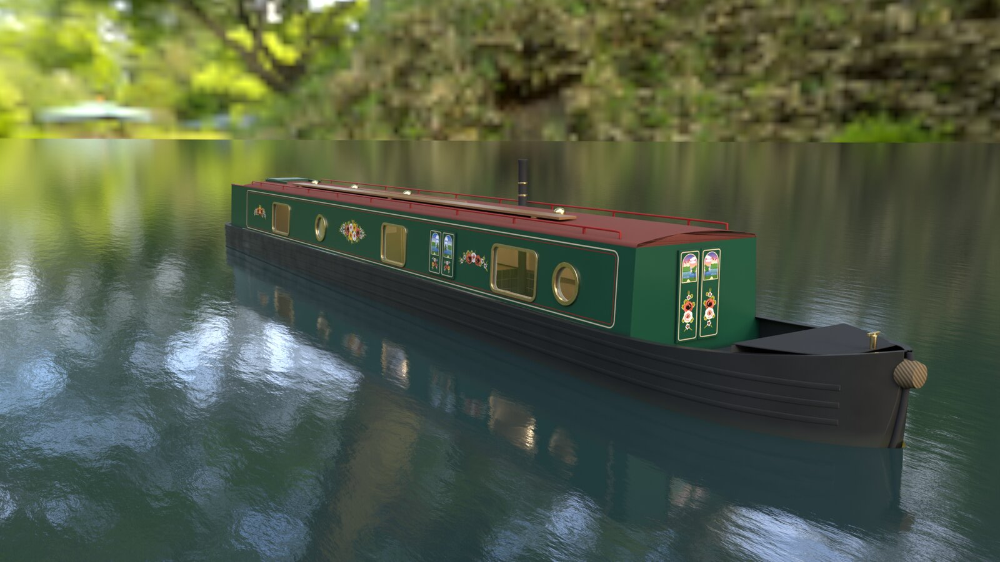
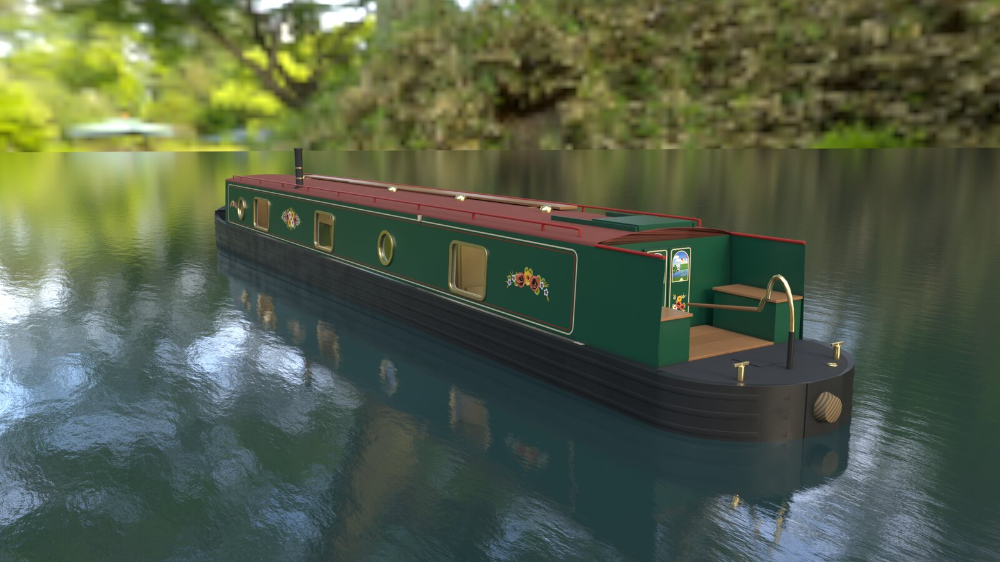
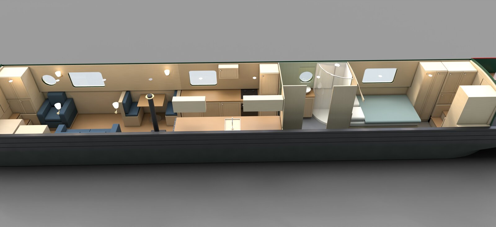
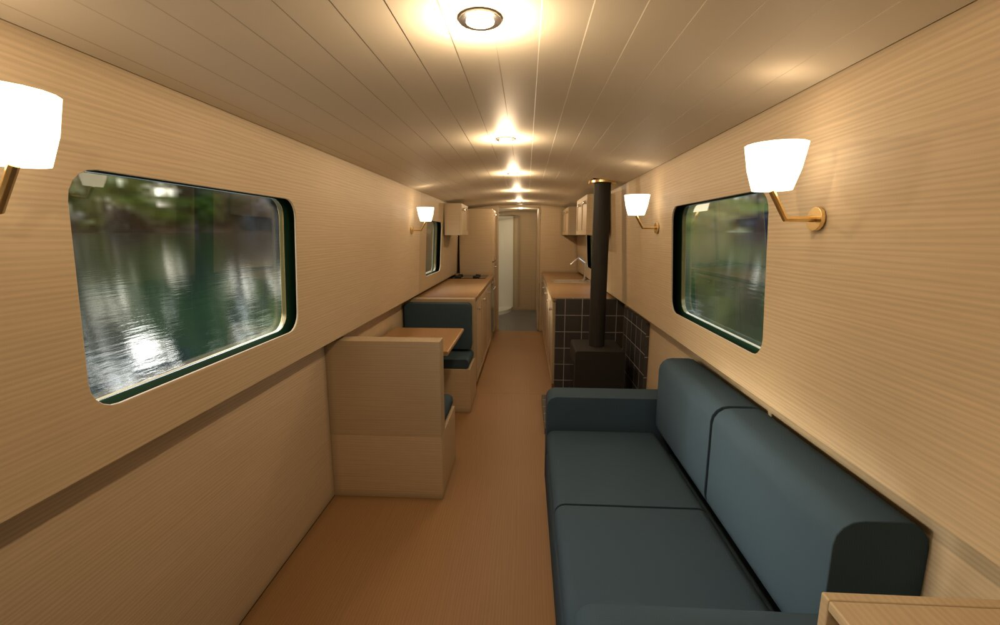
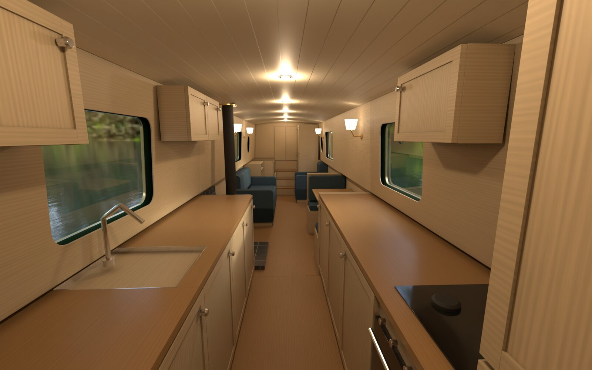
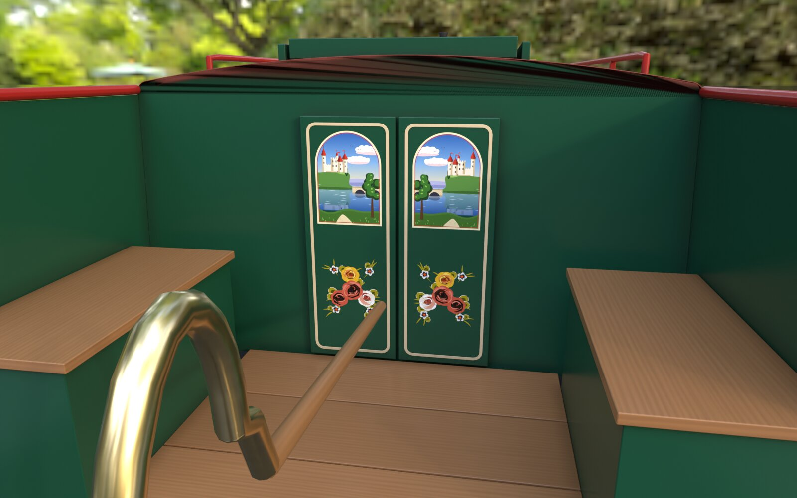
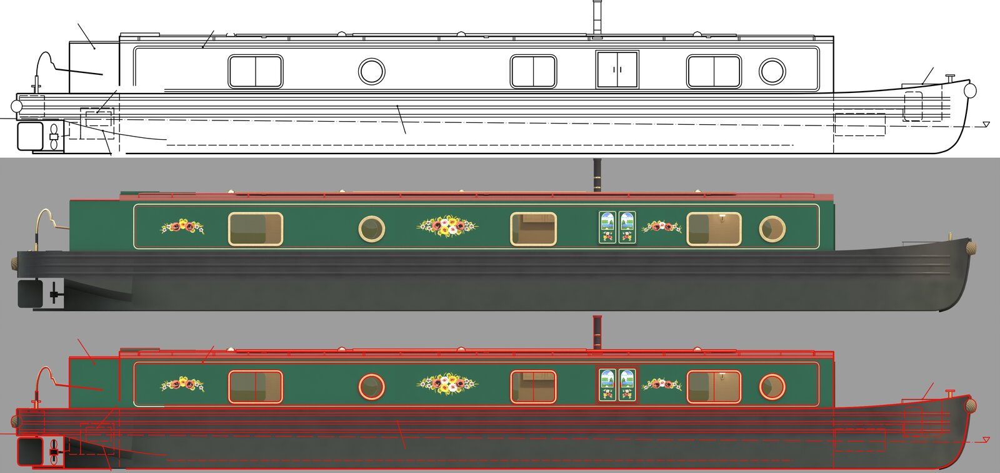
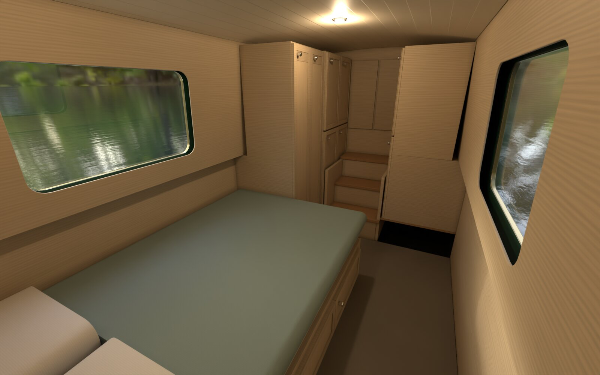
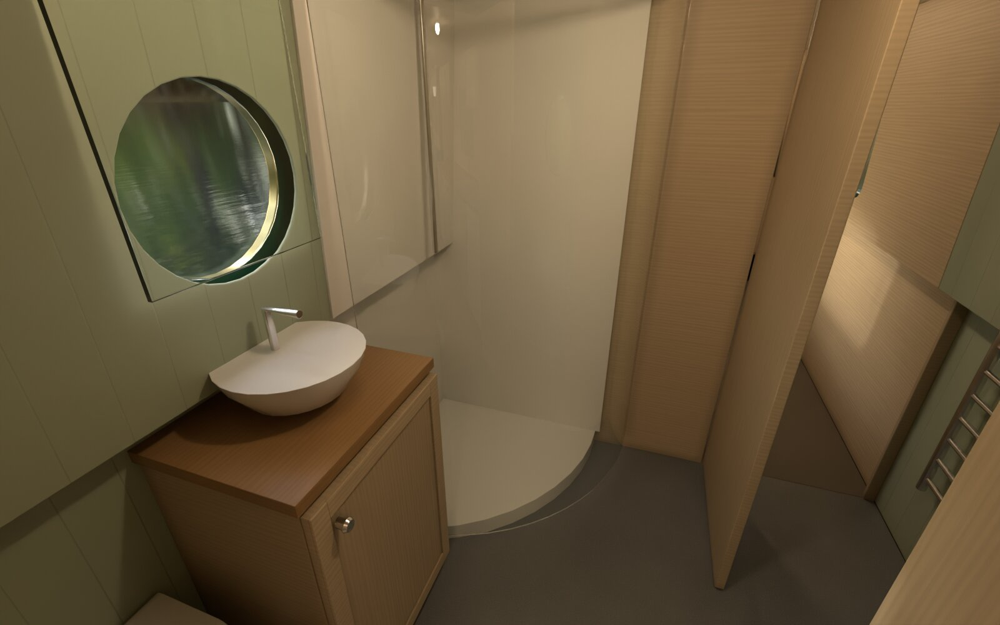
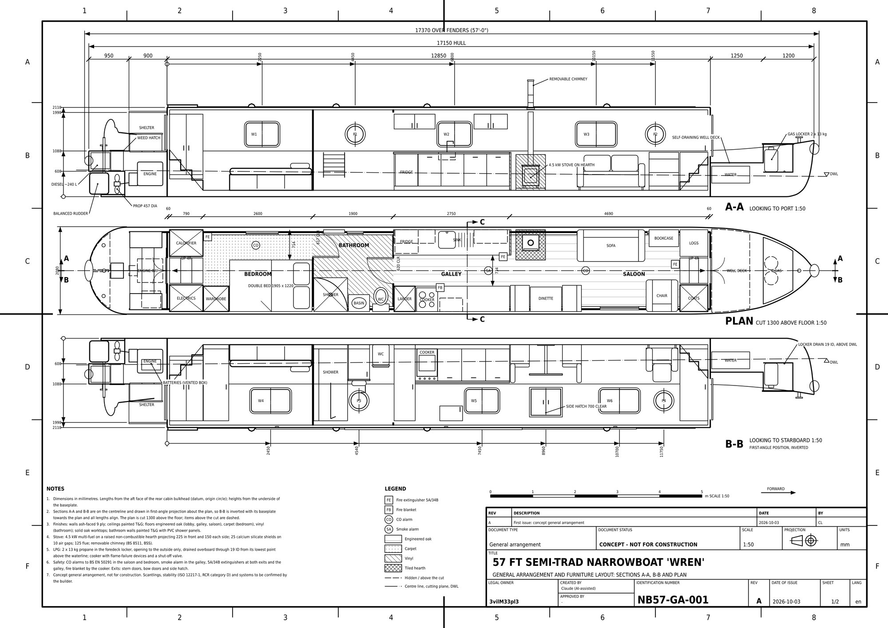

# NB57 "Wren": a procedural narrowboat for Blender



A pure-Python generator that builds **NB57 "Wren"**, an original 57 ft semi-traditional
British canal narrowboat, as a render-ready Blender scene: steel hull, cabin, semi-trad
stern, deck gear, canal-art livery and a full interior fit-out (bedroom, bathroom, galley,
saloon). Every dimension comes from one design file, which also drives a technically
drawn A3 drawing set, so the model and its drawings cannot disagree.

It also makes a **weathered** variant (rust, chips, grime, moss, dents) and the low/high
poly and wear masks to texture that variant in **Substance Painter**, which is the route to
a game-ready asset.

| | |
|---|---|
|  |  |
|  |  |
|  |  |
|  |  |

All of these are straight out of `narrowboat_build.py` (Cycles, 128 samples), lit by the
CC0 "forest" world that ships with Blender. The profile overlay is the outboard profile rendered
at drawing scale with the drawing's linework laid over it in red, which is how the build
checks itself.

The drawing set comes from the same numbers (sheet 2, the outboard profile and particulars,
is [here](docs/previews/drawing_ex.jpg)):



## What you get

- **Geometry**: about 150k triangles in 70-odd named objects, every part a closed,
  consistently wound solid with UVs. Windows and portholes are live Boolean modifiers driven
  by cutter objects, so openings stay editable.
- **Collections**: `Hull`, `Cabin`, `CabinPort`, `Roof`, `Ceiling`, `Interior`, `Lights`,
  plus hidden `Cutters` and a `Lookdev` rig. Hide `Roof`, `Ceiling` and `CabinPort` for a
  cutaway.
- **Materials**: procedural Cycles node graphs, about 45 slots: black hull, deep green
  cabin, cream and red coachlines, red-oxide roof, brass, stainless, glass, oak, ash ply,
  painted tongue and groove, carpet, vinyl and more.
- **Canal art**: roses on the cabin panels and castle scenes on the doors and hatch, all
  generated as SVG (`canal_roses.py`, `canal_castles.py`), rasterised to PNG and applied as
  alpha decals.
- **Drawings**: two A3 sheets (general arrangement at 1:50; outboard profile, roof plan,
  midship section and particulars tables) as SVG, PNG and a two-page PDF.
- **Manifest**: `narrowboat_manifest.json` lists the dimensions, every opening, decal panel
  and interior item with its bounds, the lights, per-part triangle counts and the SHA-256 of
  the generator files that made it.

## Requirements

- **Blender 5.1** (built and tested with 5.1.2). The scripts only use Blender's bundled
  Python and NumPy.
- **`rsvg-convert`** (librsvg) to rasterise the drawings and decals:
  `sudo apt install librsvg2-bin` or `brew install librsvg`.
- For the tests and the Painter script: Python 3.11+ with `numpy`, `Pillow` and `pytest`
  (`pip install -e '.[test]'`).
- Optional: **Substance 3D Painter** for the weathered texture pipeline.

## Quick start

```bash
# 1. The drawing set (plain Python, writes build/Drawings)
python3 src/narrowboat_blueprint.py

# 2. The boat: .blend, textures, previews and manifest in build/NB57
blender --background --factory-startup --python-exit-code 1 \
    --python src/narrowboat_build.py -- --hdri blender:forest

# 3. Open it
blender build/NB57/Narrowboat_NB57.blend
```

The build refuses to run against drawings made from a different design, so run step 1 again
whenever you change `narrowboat_design.py`. Builds write to a staging folder and swap it in
when they finish, so a failed run never leaves a half-written asset behind.

### Build options

| Option | Default | What it does |
|---|---|---|
| `--out DIR` | `build/NB57` | Output folder (`build/NB57-weathered` for a worn build). |
| `--samples N` | 128 | Cycles samples per preview. |
| `--no-render` | off | Build and save the `.blend` without rendering previews. |
| `--hdri FILE` | studio grey | Equirectangular `.hdr`/`.exr` for the lakeside shots. `blender:NAME` picks one of Blender's bundled CC0 worlds: `forest`, `sunset`, `sunrise`, `courtyard`, `city`. |
| `--hdri-sun DEG` | found | Azimuth of the HDRI's sun. By default it is found from the brightest pixels and the sky is turned so the sun stands behind each camera. |
| `--wear weathered` | `clean` | The weathered variant: wear maps baked to `Textures/WearMaps` and blended into the materials. |
| `--shots LIST` | all | Comma-separated shots or groups: `ortho`, `beauty`, `interior`, `wear`, or names such as `hero,saloon`. |
| `--false-colour` | off | With `--wear`, shows each wear mask in flat colour to review placement. |
| `--device cpu` | auto | Render on the CPU when the GPU is busy. |
| `--seed N` | 1 | Seed for the wear, dents and other random detail. |
| `--publish` | off | Allow a worn, partial or false-colour build to write inside `build/`. |

Without `--hdri` the exterior shots use a plain grey world, which works but looks flat.
A full clean build with previews takes a few minutes on a desktop GPU.

### Output

```
build/NB57/
├── Narrowboat_NB57.blend        # the scene, textures linked relatively
├── Textures/                    # decal SVGs and PNGs (and WearMaps/ for a worn build)
├── Reference/                   # a copy of the drawing set the build was checked against
├── Previews/                    # nb_*.png renders and drawing overlays
└── narrowboat_manifest.json
```

## Units and axes

Metres. +X towards the bow, +Y to port, Z up. `z = 0` is the underside of the baseplate and
the origin is at mid-hull. Inside the design file, lengths are millimetres measured from the
aft face of the rear cabin bulkhead (`b`), as on the drawings.

## Taking it into a game engine

The `.blend` is a lookdev scene: its materials are procedural Cycles graphs, which no game
engine reads, and the hull and cabin are dense where Booleans cut them. For an engine-ready
exterior, use the Painter route:

```bash
# 1. Low and high poly per texture set, with livery and wear-potential maps
blender --background --factory-startup --python-exit-code 1 \
    --python src/narrowboat_bakeprep.py -- --out build/bakeprep --size 4096

# 2. With Substance Painter running with --enable-remote-scripting
python3 src/narrowboat_painter.py all --prep build/bakeprep --out build/painter

# 3. Optional: render the textured low poly to check it
blender --background --factory-startup --python-exit-code 1 \
    --python src/narrowboat_build.py -- --wear weathered \
    --painted build/bakeprep build/painter/textures --out build/painted-check
```

`narrowboat_bakeprep.py` splits the exterior into six texture sets (`Hull`, `Cabin`, `Ends`,
`Roof`, `Decks`, `Fittings`) and writes `Mesh/NB57_low.fbx` (clean, unwrapped into 0-1 with no
overlaps) and `Mesh/NB57_high.fbx` (dented and densified, with the paint overlays), plus the
clean livery, metallic/roughness and packed wear-potential masks for each set.
`narrowboat_painter.py` drives Painter over its remote-scripting API: it creates the project,
bakes normal, AO, curvature, position, thickness and height, builds a layer stack per set
(livery, grime, stains, verdigris, chips to primer, rust, polish, algae, moss, soot, standing
water) and exports BaseColor, Normal (OpenGL and DirectX), Height, Roughness, Metallic and AO.

The interior is not part of the texture sets; export it from the `.blend` and rebuild its
materials in your engine if you need it.

## Changing the boat

`src/narrowboat_design.py` is the single source of truth: principal dimensions, plate
thicknesses, heights, the interior zones, window and porthole positions, tankage and so on,
in millimetres. It is written to real constraints (Canal & River Trust lock dimensions, the
Standedge tunnel profile, Boat Safety Scheme ventilation and LPG rules, BS 8511 stove
clearances), and `tests/test_narrowboat_design.py` checks them, so the tests tell you when a
change breaks something a real boat would have to meet.

After editing it: run the tests, rebuild the drawings, then rebuild the boat.

## How the code is laid out

| Module | Role |
|---|---|
| `narrowboat_design.py` | The design as data (stdlib only). |
| `narrowboat_lines.py` | Hull lines and sections derived from the design. |
| `narrowboat_common.py` | Exterior geometry (hull, cabin, stern, deck gear), openings and decal panels. No `bpy`. |
| `narrowboat_interior.py` | The fit-out. No `bpy`. |
| `narrowboat_build.py` | The Blender entry point: materials, objects, cameras, lake, previews, manifest. |
| `narrowboat_blueprint.py`, `drawing_svg.py` | The A3 drawing set as SVG/PNG/PDF. |
| `canal_roses.py`, `canal_castles.py` | Procedural canal art as SVG. `canal_roses.py` also runs on its own to make a sheet of rose designs. |
| `narrowboat_wear.py`, `narrowboat_dents.py`, `narrowboat_weathered.py`, `procgen_masks.py` | Wear maps, dents and the weathered materials. |
| `narrowboat_bakeprep.py`, `narrowboat_painter.py` | The Substance Painter pipeline. |
| `procgen_mesh.py`, `procgen_bpy.py` | Shared mesh building (closed solids, lofts, sweeps) and Blender helpers. |

Geometry is built as plain Python data first and only handed to Blender at the end, which is
why most of it is testable without Blender.

## Tests

```bash
python3 -m pytest
```

About 320 tests, all outside Blender: the design rules, hull lines, every part being a closed
outward solid, interior clearances, the drawings, canal art and wear maps. They need
`rsvg-convert` for the drawing tests.

## Licence

MIT, see [LICENSE](LICENSE). The design, drawings and canal art are original and generated
by this code. No HDRI is included; `blender:NAME` uses the CC0 Poly Haven worlds that ship
with Blender.
